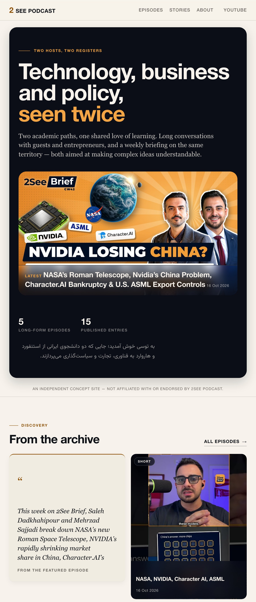
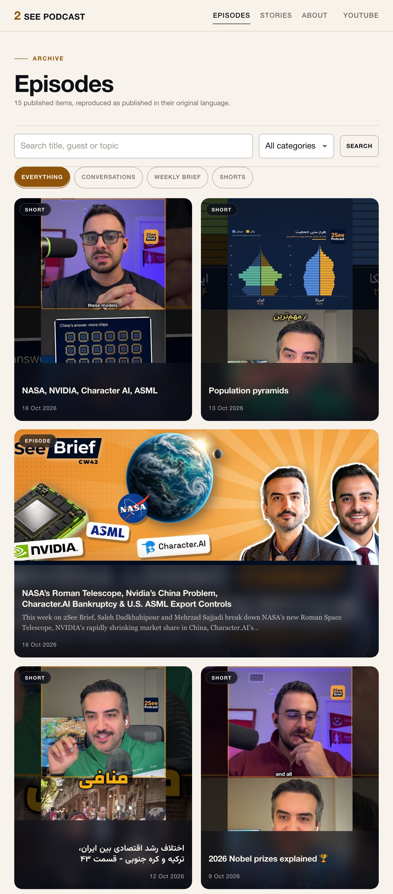
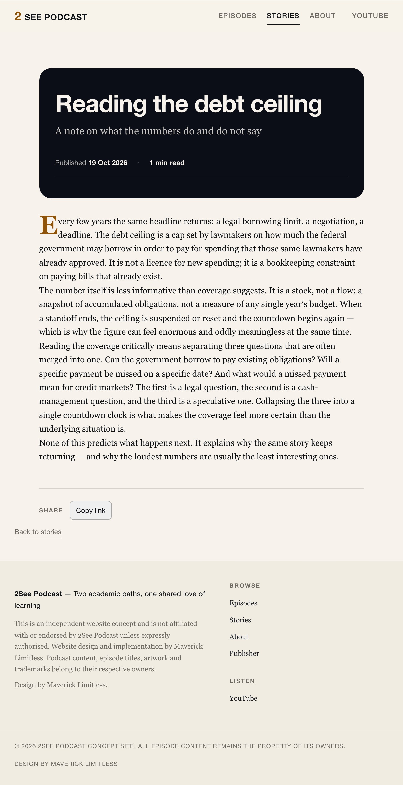
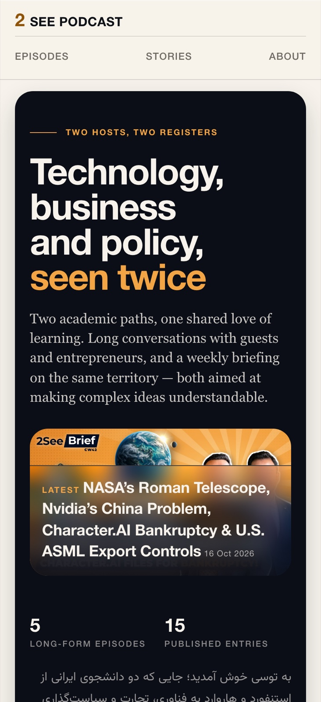
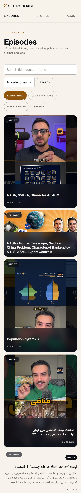
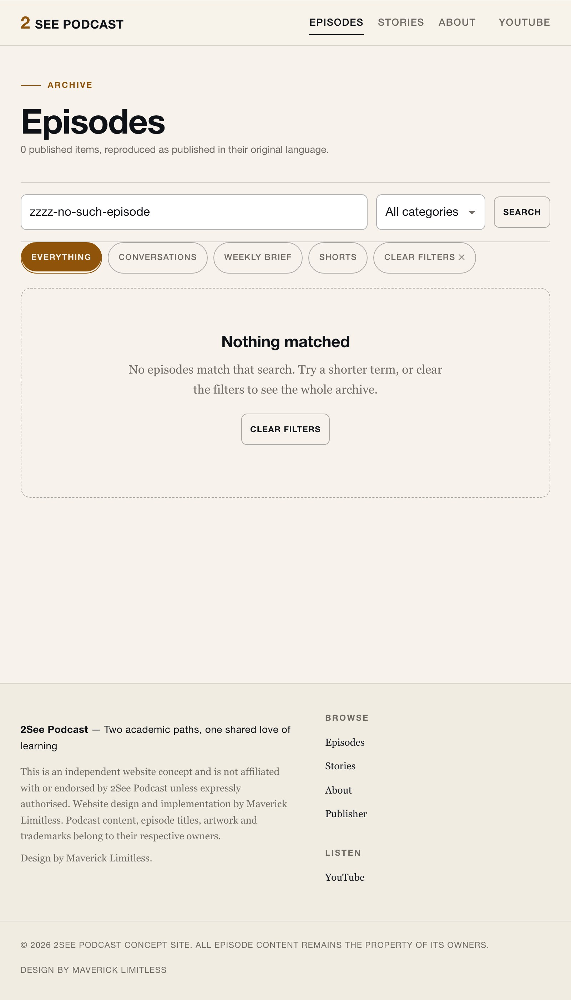

# 2See Podcast — an independent editorial website concept

A bespoke, editorial digital home for **2See Podcast**: a Pinterest-inspired discovery archive for episodes, a reading experience for editorial stories, and a minimal single-user publishing panel — in one self-contained codebase.

**Design by Maverick Limitless.** This is an independent concept, proposed to the podcast's hosts. It is **not** an official 2See website and is not affiliated with or endorsed by the programme unless expressly authorised.



*Every image in this README is a real capture of the running build. The complete gallery — every route, mobile and desktop, including the publishing panel and the empty and load-more states — is in the [screenshot index](docs/assets/screenshots/README.md).*

## The problem / The solution

A podcast's presence can end up scattered: long episodes on YouTube, short clips, and written ideas live in different places, so a listener who wants to *understand the programme*, find a relevant episode, or read around a topic has no single destination.

**The solution** is one independent digital home that gathers the programme's identity, its video archive, its editorial writing, and its story — while YouTube remains the publishing platform where playback happens.

| | |
| --- | --- |
|  |  |
| *Episodes archive — glass-on-image discovery with Persian titles preserved* | *Story reading — editorial layout with the signature opening panel* |



| | |
| --- | --- |
|  |  |
| *Mobile archive — nothing clipped at phone width* | *Search that matches nothing — a real empty state* |

## What's included

**Public site** — home with an editorial opening on the programme's own deep-navy ground; episodes archive with search, format filters, an in-place "load more" and Persian-capable text; episode pages with a privacy-preserving `youtube-nocookie` embed; a stories archive and reading experience; an about page; 404 and error states; sitemap and robots.

**Publishing panel** — exactly one administrator; Markdown stories with sanitised preview; episodes added by pasting a YouTube URL *or* synchronised from the channel (Data API when configured, public feed otherwise); drafts, publishing, deletion with confirmation; site settings and password rotation.

**Bilingual by design** — English interface, original Persian titles and descriptions preserved verbatim with correct RTL shaping (Vazirmatn), and mixed-script isolation everywhere.

**Optional, configuration-dependent**: automatic YouTube synchronisation (`YOUTUBE_API_KEY` or `YOUTUBE_CHANNEL_ID`), absolute canonical URLs (`PUBLIC_ORIGIN`).

## Technology

SvelteKit 2 + Svelte 5 + TypeScript, rendered on the server. **SQLite via Node's built-in `node:sqlite`** — no database server, no native compilation, one process. Password hashing with Node's built-in scrypt. Self-hosted fonts. No tracking, no analytics. [Architecture →](docs/ARCHITECTURE.md)

## Run it locally

Requires **Node ≥ 22.5** and npm. From a clean clone:

```bash
npm install
cp .env.example .env        # then edit .env — every placeholder is explained there
npm run dev                 # http://localhost:5173
```

Two variables matter most for a local run: `ORIGIN` (SvelteKit's same-site origin; without it a plain-HTTP deployment rejects every login) and `SESSION_SECRET` (generate with `openssl rand -base64 48`). All variables are documented in [`.env.example`](.env.example).

## Set up the publishing panel

A fresh checkout has **no working password**. Create the one administrator:

```bash
npm run init:admin          # prints a cryptographically secure password once
npm run seed:episodes       # optional: import the channel's recent uploads as drafts
```

Then sign in at `/admin` with the username `tosi-podcast`. Publishing, editing, synchronisation and settings are covered in [Content management →](docs/CONTENT-MANAGEMENT.md).

## Test and verify

```bash
npm run check              # svelte-check + TypeScript
npm test                   # 106 unit + integration tests
npm run test:e2e            # 21 Playwright browser tests (Chromium) — fully
                           # self-contained: recreates its test database from
                           # a committed fixture and starts its own server
npm run build              # production build
```

What is and isn't covered: [Testing →](docs/TESTING.md) · [Test report →](TEST-REPORT.md)

## Deploy, back up, maintain

One Node process and one SQLite file — any host with a persistent filesystem works. Full guide including domain/HTTPS, backups and health checks: [Deployment →](docs/DEPLOYMENT.md). Design tokens and customisation: [Customization →](docs/CUSTOMIZATION.md).

## Current status and limitations

- Verified research drives all demo content: [Research →](docs/RESEARCH.md)
- Browser tests run Chromium only; Firefox/WebKit untested
- No performance scores claimed (no Lighthouse run in the build environment)
- A human screen-reader audit has not been performed
- The synchronisation fallback reads the channel's public feed, which carries only recent uploads and no durations

## Ownership, licence, contact

Source-available under a **proprietary licence**: public visibility is not a commercial licence, and commercial deployment requires written permission. [Licensing →](docs/LICENSING.md) · [Third-party notices →](docs/THIRD-PARTY-NOTICES.md) · [Security →](docs/SECURITY.md)

Episode titles, descriptions, artwork, videos and trademarks belong to their respective owners and remain theirs.

— *Design by Maverick Limitless*
