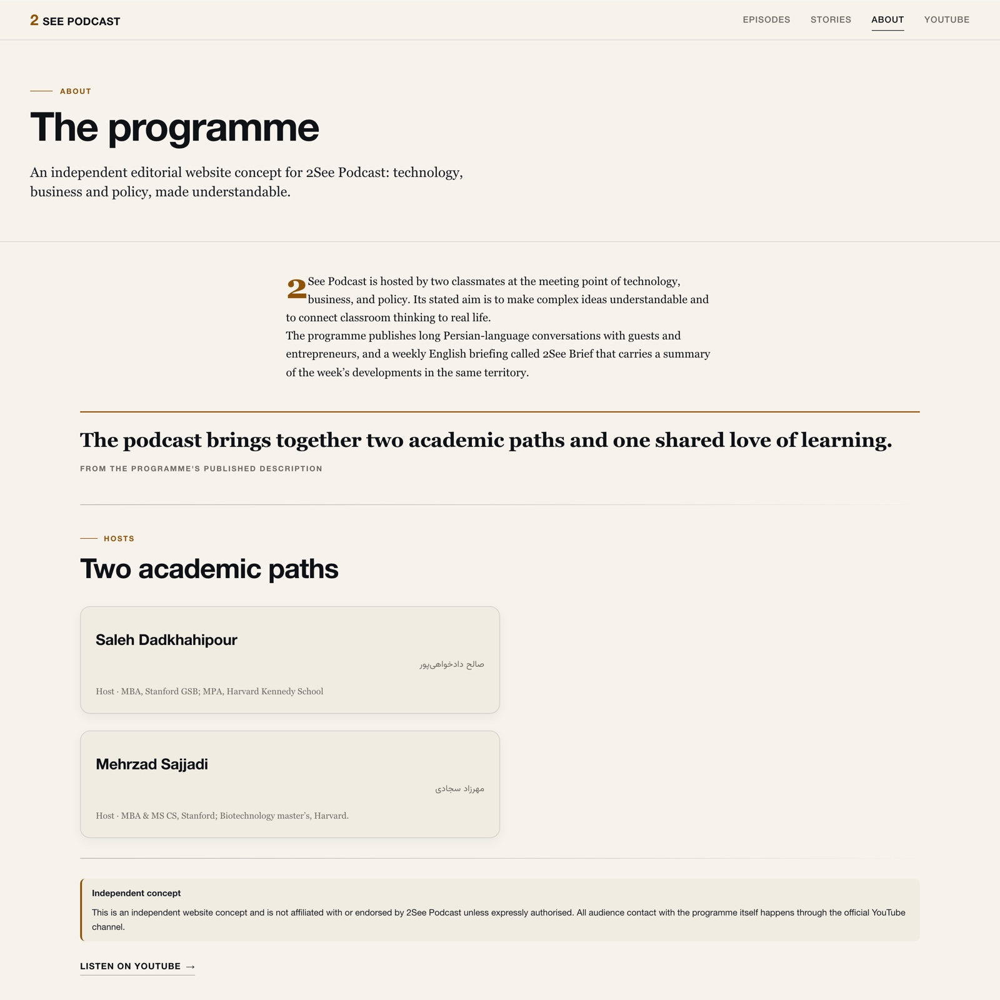
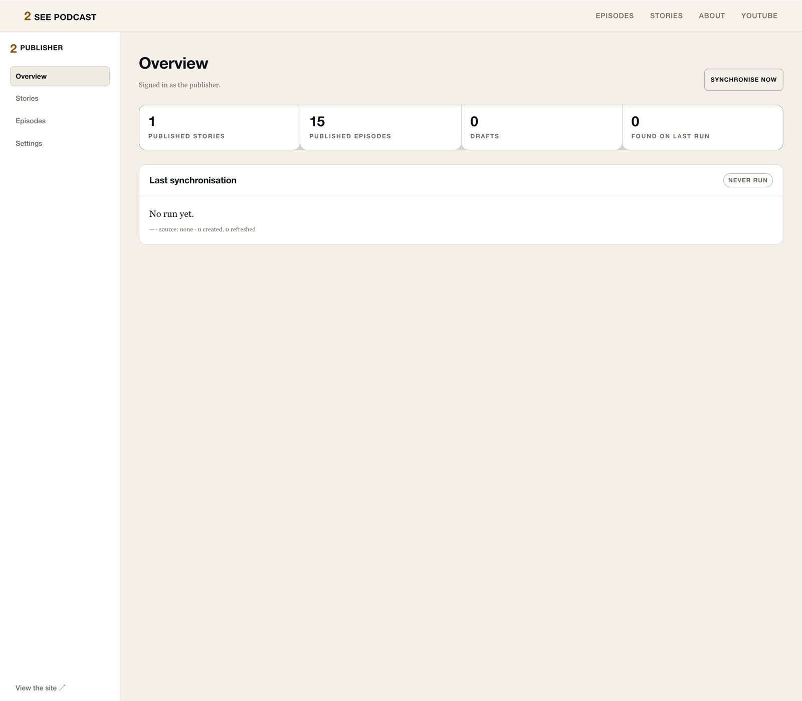

# 2See Podcast — pitch

*A six-part presentation, ready to show. Built for a direct conversation with Saleh and Mehrzad — not an investor deck. All images are real captures of the running product; no audience numbers or financial claims appear anywhere, because none have been measured.*

---

## 1 — The idea

**One independent digital home for the complete 2See experience.**

A website that belongs to the programme: its identity, its full episode archive, its editorial writing, and the story of the two people behind it — gathered into one place that listeners can explore and the hosts fully control.

*This is a proposed, independent concept. Nothing on the site claims endorsement by 2See until you say yes.*

---

## 2 — The problem

A channel-first workflow scatters the programme.

Today the show lives where it was uploaded: long episodes, short clips, and any written thinking each exist on YouTube's terms, in YouTube's layout. Someone who wants to know what 2See *is*, find the episode about a specific question, or read around a topic has no destination that presents the whole programme.

That gap is what this product fills — without touching your publishing workflow. YouTube remains exactly where your videos live.

---

## 3 — The solution

**A single editorial destination.**

- **Discover** — a visual, browsable archive instead of a reverse-chronological upload list
- **Understand** — an about page built only from verified, public facts about the programme
- **Read** — editorial writing as a first-class experience, not a description field
- **Watch** — every episode page embeds the official player and links back to YouTube

Bilingual by design: Persian titles and descriptions appear exactly as published, correctly shaped right-to-left, alongside the English interface.

---

## 4 — The product

*The home page. The opening states the programme's premise on its own deep-navy ground; the current lead episode answers on the right.*

| | |
| --- | --- |
|  |  |
| **Discovery** — glass-on-image episode cards, format filters, Persian search | **Reading** — editorial layout with the signature opening panel and reading progress |

| | |
| --- | --- |
|  |  |
| **The programme** — hosts, purpose, and an honest independence note | **The panel** — one secure account; you publish, you control |

**Built-in:** search · format filters · drafts & publishing · episode sync from your channel · Markdown stories with safe rendering · sitemap · installable as an app

---

## 5 — Why it matters

**Brand.** A presentation derived from your own artwork — the navy, the amber, the pairing of two voices — instead of a platform template.

**Discoverability.** Every episode has a shareable page with its full title, description and metadata, findable by search — in Persian or English.

**An archive you own.** The catalogue lives on your infrastructure, not inside a platform's navigation. Back it up, move it, keep it.

**Video and writing, connected.** The site is built for both: episodes and editorial stories link to each other and share one design language.

**Your content, your control.** One private panel; you add, edit, publish or unpublish everything. No accounts for readers, no tracking, no third-party scripts.

These are the design's purposes — potential value, not measured outcomes. No growth, audience or revenue claims are implied.

---

## 6 — Technology and next step

**Deliberately small.** One Node.js process. One SQLite file. No external database, no queue, no vendor lock-in — runs on any host with a persistent disk. Node ≥ 22.5, open mainstream stack (SvelteKit, TypeScript), 119 automated tests, documented deployment and backups.

**Complexity:** low to operate (one process, one file), medium to extend (a real design system and correctness-tested publishing workflows).

**What the next step looks like:**

1. You look at the running site — every screenshot here is from the build you can have
2. If it resonates: your channel data is imported, your copywriting replaces mine, your domain hosts it
3. The licence and any customisation are a written agreement between us — the code stays yours to run

**Contact:** Maverick Limitless — for licensing and deployment discussion.
